# Class Activity 1 — System Calls in Practice

**Student:** Seng Monika  
**Course:** Operating Systems  
**Topic:** Using POSIX System Calls in Linux  
**Environment:** Ubuntu on WSL2  
**Language:** C

## 1. Objective

The objective of this activity is to understand the difference between C library functions and POSIX system calls. I implemented file operations using both methods, examined their behavior using `strace`, and explored the Linux operating system through the `/proc` filesystem.

## 2. Warm-Up Examples

### Hello System Call

I compiled and executed `hello_syscall.c`, which uses `write()` to display a message in the terminal.

**Output:**
```
Hello, System Call!
```

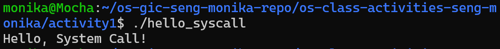

### File Copy Using System Calls

I executed `copyfilesyscall.c`, which copies the contents of `result.txt` into `copyresult.txt`.

**Output:**
```
File copied successfully!
```

The command `cmp result.txt copyresult.txt` returned exit code `0`, confirming that both files contain identical data.

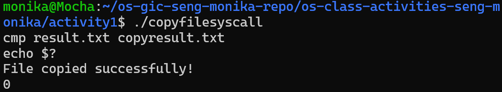

## 3. Task 1 — File Creator and Reader

### Part A: File Creator

I compared two implementations:

- Library version: `fopen()`, `fprintf()`, and `fclose()`.
- System-call version: `open()`, `write()`, and `close()`.

Both programs successfully created `output.txt` containing:

```
Hello from Operating Systems class!
```

**Library version:**

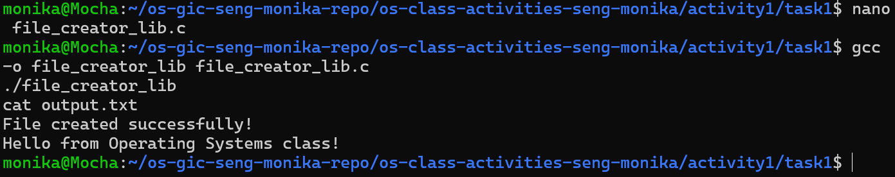

**System-call version:**

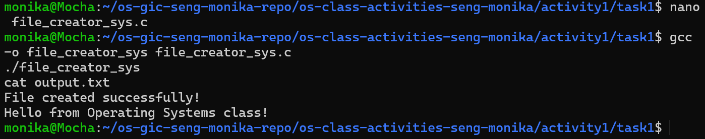

### Questions — Part A

**1. What flags did you pass to `open()`?**

I used `O_WRONLY | O_CREAT | O_TRUNC`.

- `O_WRONLY` opens the file for writing.
- `O_CREAT` creates the file if it does not exist.
- `O_TRUNC` clears the existing contents of the file.

**2. What does `0644` mean?**

`0644` represents file permissions in octal notation.

- `0` indicates octal notation and no additional special permission bits.
- `6` means the owner can read and write.
- `4` means the group can read.
- `4` means other users can read.

**3. What does `fopen("output.txt", "w")` do internally?**

`fopen()` uses the C standard library to manage file opening and buffering. It ultimately requests the operating system to open or create the file. With `open()`, I explicitly specified the access flags and permissions and managed the file descriptor myself.

### Part B: File Reader

I implemented file reading using two approaches:

- Library version: `fopen()`, `fgets()`, `printf()`, and `fclose()`.
- System-call version: `open()`, `read()`, `write()`, and `close()`.

Both programs displayed the same file contents.

**Library version:**

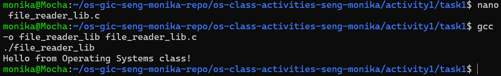

**System-call version:**


### Questions — Part B

**1. What does `read()` return? How is it different from `fgets()`?**

`read()` returns the number of bytes successfully read. It returns `0` at the end of the file and `-1` when an error occurs.

`fgets()` returns a pointer to the buffer when successful and `NULL` when no line is read due to end-of-file or an error. It reads a line or stops when its buffer limit is reached.

**2. Why do you need a loop when using `read()`? When does it stop?**

A loop is necessary because one `read()` call may not retrieve all file contents. The program continues reading until `read()` returns `0`, indicating the end of the file. An error is indicated by `-1`.

## 4. Task 2 — Directory Listing and File Information

In this task, I implemented two programs to display filenames and file sizes from the current directory.

- Library version uses `printf()` for output.
- System-call version uses `snprintf()` for formatting and `write()` for output.

Both programs use `opendir()`, `readdir()`, and `stat()` to access directory information.

**Library version:**

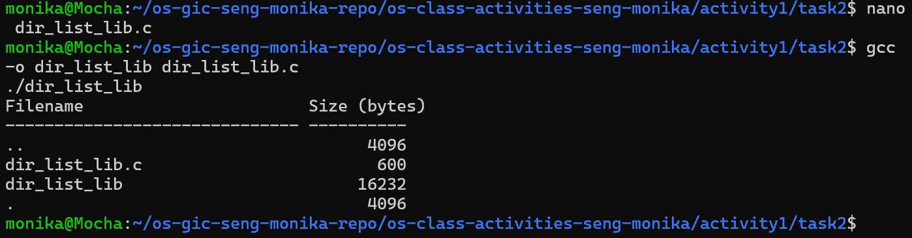

**System-call version:**

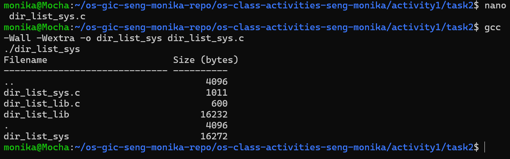

### Questions

**1. What struct does `readdir()` return? What fields does it contain?**

`readdir()` returns a pointer to `struct dirent`, which contains information about a directory entry. Common fields include:

- `d_name`: Filename.
- `d_ino`: Inode number.
- `d_type`: File type, when available.
- `d_reclen`: Directory entry record length.

**2. What information does `stat()` provide beyond file size?**

`stat()` provides information such as file permissions, file type, inode number, owner ID, group ID, link count, and file timestamps.

**3. Why is `snprintf()` needed before `write()`?**

`write()` outputs raw bytes and does not format numbers. `snprintf()` converts the filename and numeric file size into a formatted character string. The resulting bytes can then be displayed using `write()`.

## 5. Task 3 — System Call Analysis Using strace

I used `strace` to observe system calls generated by the library and system-call versions.

### File Creator — Library Version

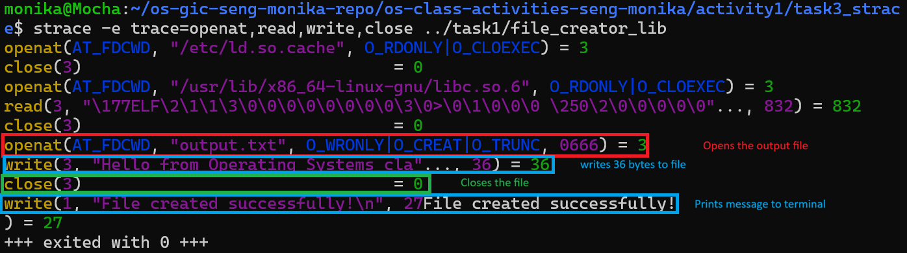

### File Creator — System-Call Version

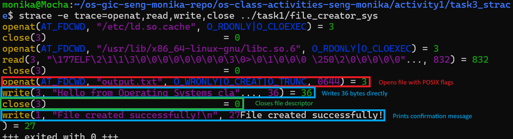

### File Reader — Library Version

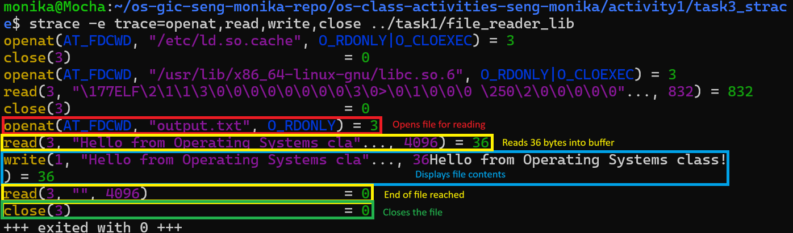

### File Reader — System-Call Version

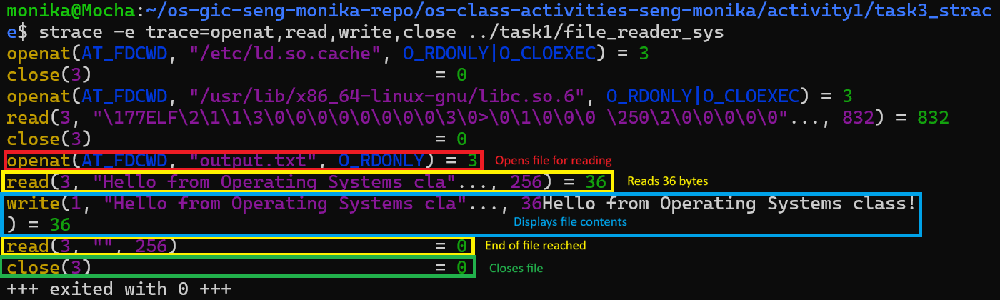

### System Call Summary

**Library version:**

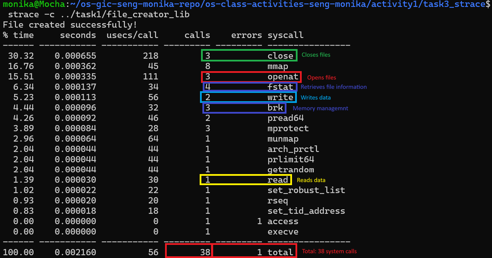

**System-call version:**

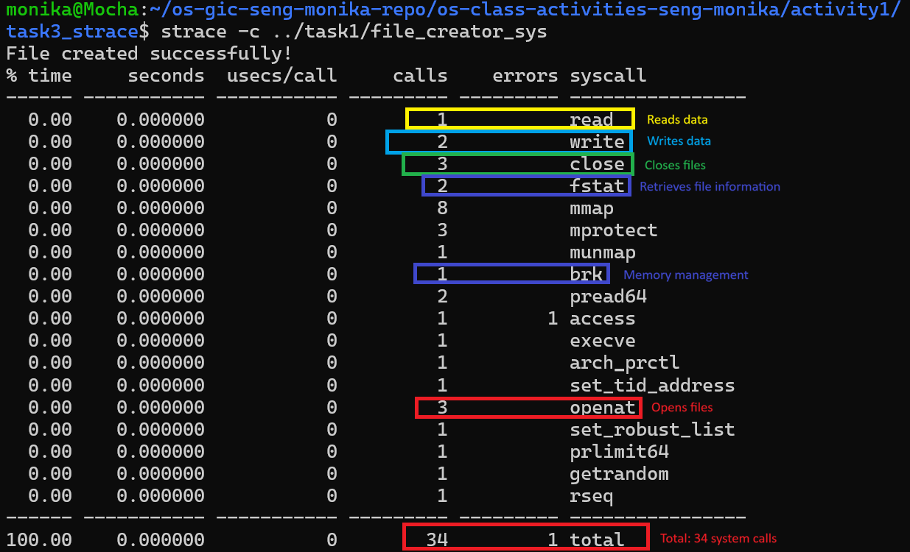

### Comparison Results

| Measurement | Library Version | System-Call Version |
|---|---:|---:|
| Total system calls | 38 | 34 |
| `openat()` calls | 3 | 3 |
| `read()` calls | 1 | 1 |
| `write()` calls | 2 | 2 |
| `close()` calls | 3 | 3 |
| `fstat()` calls | 4 | 2 |
| `brk()` calls | 3 | 1 |
| Reported syscall errors | 1 | 1 |

### Questions

**1. How many system calls does each version make?**

The library version made 38 system calls, while the system-call version made 34. Therefore, the library version made four additional system calls.

**2. What extra system calls appear in the library version?**

Both versions use many of the same system-call types, but the library version made two more `fstat()` calls and two more `brk()` calls.

- `fstat()` retrieves information about an open file.
- `brk()` adjusts the process data segment used for memory allocation.
- `mmap()` maps memory regions into a process. Both versions made eight `mmap()` calls.

These differences can arise from additional work performed by the C library.

**3. How many `write()` system calls does `fprintf()` produce?**

For the file contents, the trace showed one `write()` system call writing 36 bytes. Another `write()` call displayed the 27-byte confirmation message.

The library can buffer data before sending it to the operating system, so individual library-level output operations do not necessarily correspond to individual `write()` system calls.

**4. What is the difference between library functions and system calls?**

A library function is a function provided by a programming library to simplify development. A system call requests a service from the operating system kernel.

For example, `fprintf()` handles formatted output and buffering, while `write()` sends bytes through the operating system's system-call interface.

## 6. Task 4 — Exploring OS Structure

### Part A: System Information

I explored the Linux kernel and system information using `uname` and files under `/proc`.

**Observed system information:**

| Component | Value |
|---|---|
| Operating environment | Ubuntu on WSL2 |
| Kernel version | 6.6.87.2-microsoft-standard-WSL2 |
| CPU | Intel Core i7-12700H |
| CPU architecture | x86_64 |
| CPU cores reported | 10 |
| Memory visible to WSL2 | 7,937,184 kB |

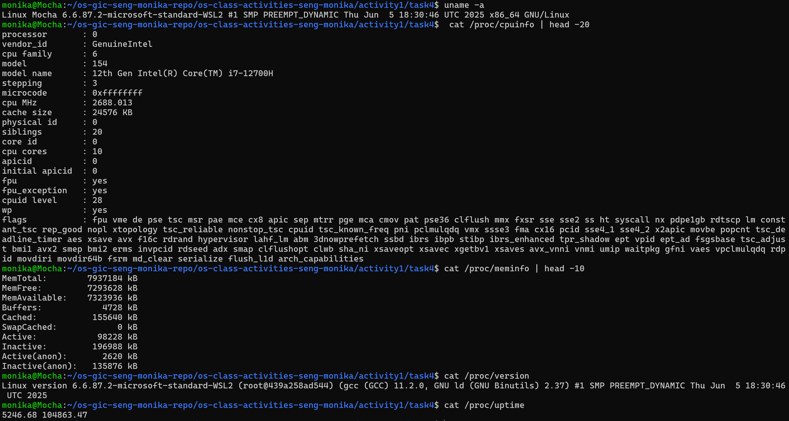

### Part B: Process Information

I examined process status, memory mappings, command-line information, and running processes.

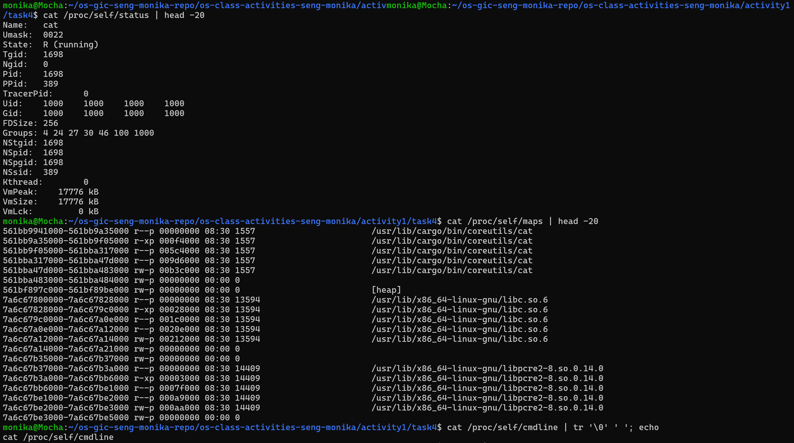

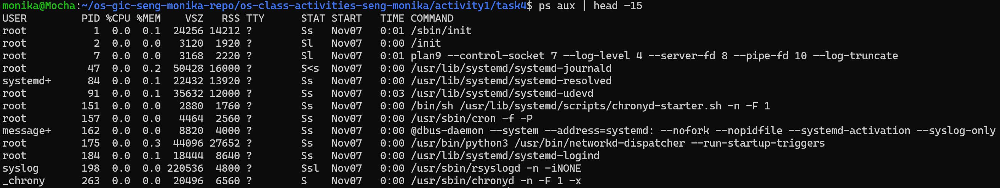

### Part C: Kernel Modules

The `lsmod` command displayed loaded modules, including `kvm_intel`, `kvm`, `battery`, and `bridge`.

Using `modinfo kvm_intel`, I confirmed that `kvm_intel` depends on the `kvm` module and is associated with the WSL2 kernel.

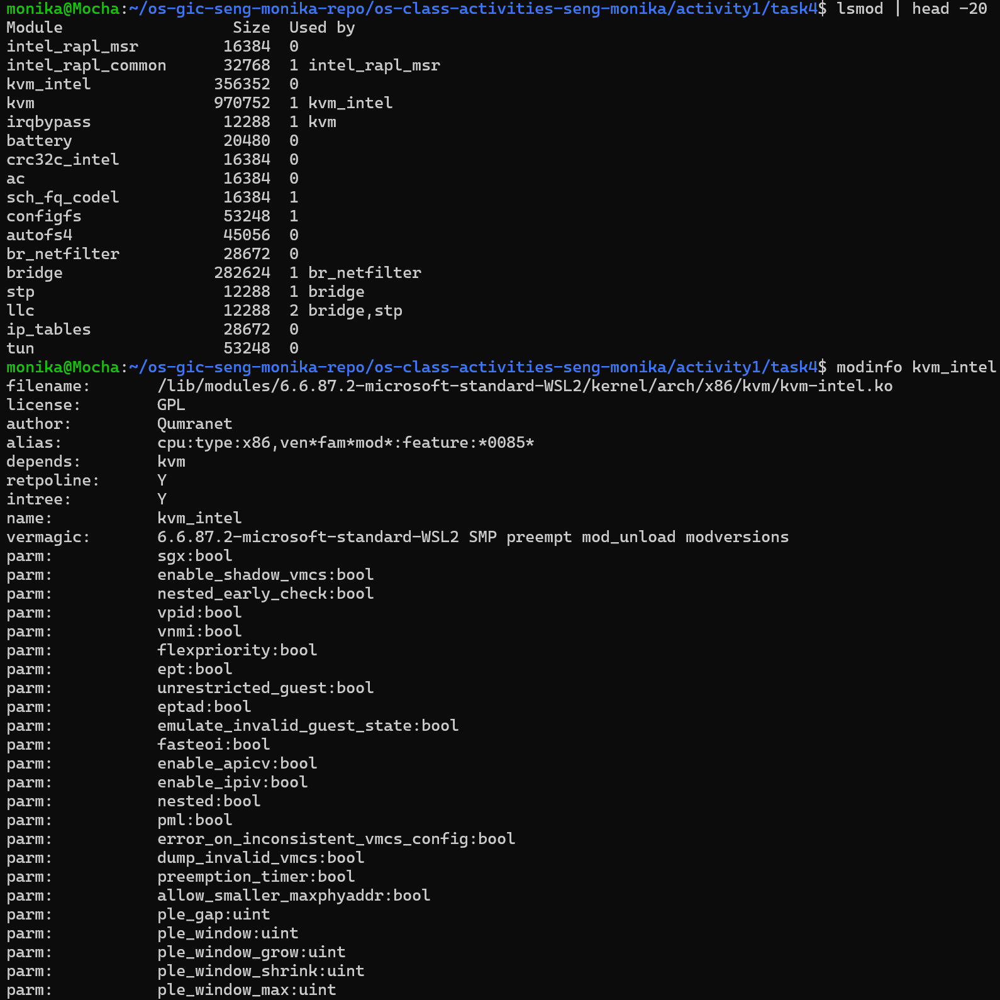

### Part D: OS Layers Diagram

The diagram illustrates the relationships between user applications, system calls, the Linux kernel, the WSL2 virtual machine, and physical hardware.

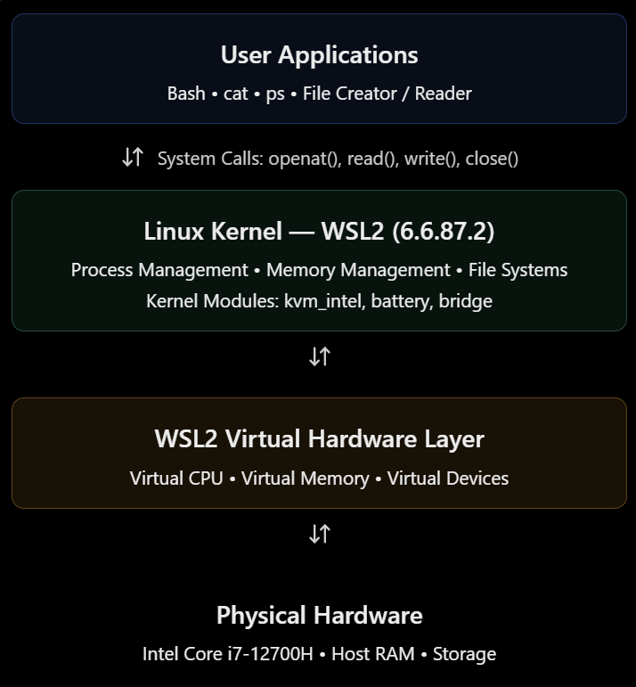

### Questions

**1. What is `/proc`? Is it a real filesystem on disk?**

`/proc` is a virtual filesystem generated by the Linux kernel. It exposes system and process information dynamically rather than storing ordinary files on disk.

**2. What is the difference between a monolithic kernel and a microkernel? Which does Linux use?**

A monolithic kernel runs major operating system services, such as memory management, file systems, and device drivers, in kernel space.

A microkernel keeps a smaller set of core functions in kernel space and runs more services outside the kernel.

Linux uses a modular monolithic kernel. Its modules can extend kernel functionality without requiring every component to be built permanently into the kernel image.

**3. What memory regions appear in `/proc/self/maps`?**

The output contained memory regions associated with:

- The executable program (`cat`).
- The heap (`[heap]`).
- Shared libraries such as `libc.so.6`.
- Read-only, executable, and writable mappings.

Permission flags such as `r-xp` and `rw-p` indicate the allowed access to different memory regions.

**4. What does the kernel version string mean?**

The command `uname -a` reported:

```
Linux Mocha 6.6.87.2-microsoft-standard-WSL2 #1 SMP PREEMPT_DYNAMIC Thu Jun 5 18:30:46 UTC 2025 x86_64 GNU/Linux
```

- `Linux`: Kernel name.
- `Mocha`: Computer hostname.
- `6.6.87.2`: Kernel release version.
- `microsoft-standard-WSL2`: Microsoft's WSL2 kernel build.
- `#1`: Kernel build identifier.
- `SMP`: Support for symmetric multiprocessing.
- `PREEMPT_DYNAMIC`: Dynamic kernel preemption configuration.
- Date and time: Kernel build timestamp.
- `x86_64`: 64-bit x86 architecture.
- `GNU/Linux`: Operating system designation.

**5. How does `/proc` demonstrate that the OS is an intermediary between programs and hardware?**

Programs can read information from `/proc` without directly accessing hardware. The kernel collects and manages the underlying information and exposes it through a controlled interface.

For example, `/proc/cpuinfo` provides processor information, while `/proc/meminfo` describes memory managed by the kernel.

## 7. Reflection

Through this activity, I learned how C library functions and POSIX system calls interact with the operating system. I practiced creating, reading, and copying files and listing directory contents using C.

The most interesting observation came from `strace`. Although both file creator versions produced identical output, the library version made 38 system calls while the system-call version made 34.

I also learned how the `/proc` filesystem exposes information about processes, memory, the kernel, and loaded modules.

This activity helped me understand how user programs communicate with the Linux kernel and why system calls are essential to operating systems.
