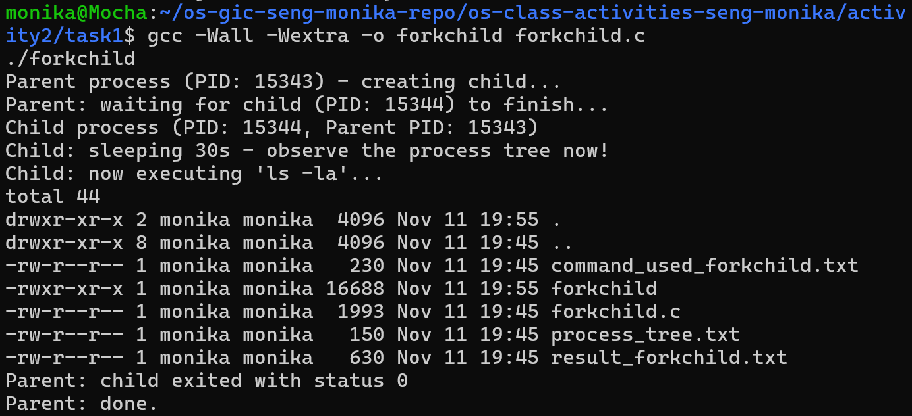
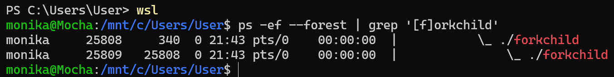
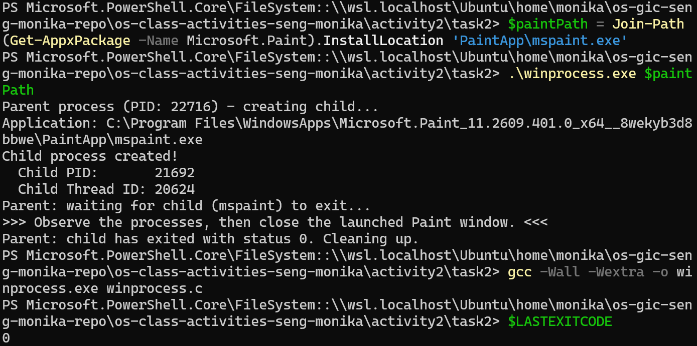
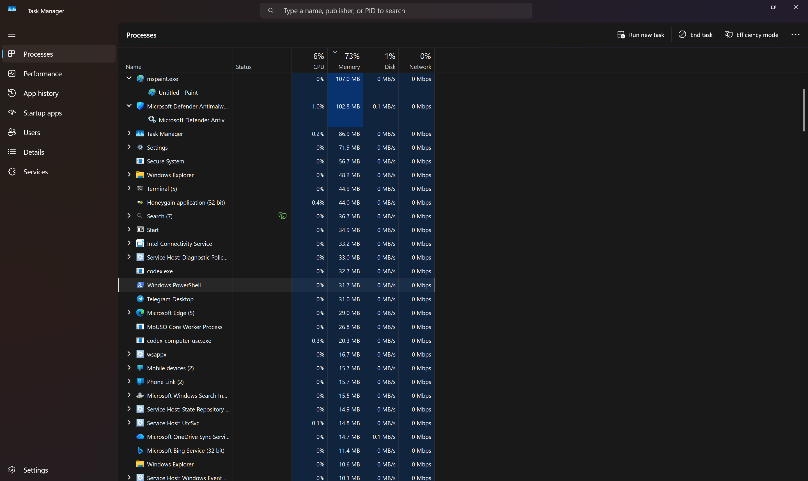
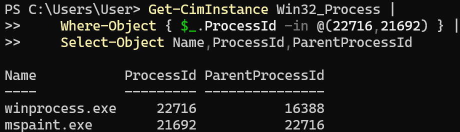
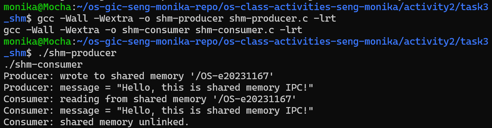
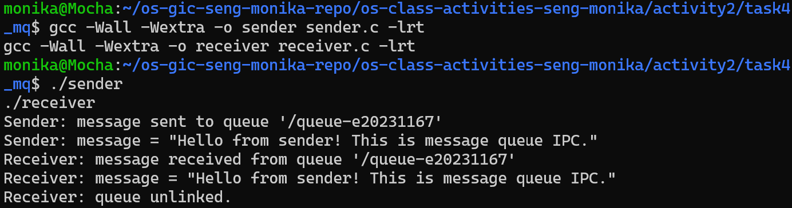

# Class Activity 2 — Processes & Inter-Process Communication

- **Student Name:** Seng Monika
- **Student ID:** e20231167
- **Course:** Operating Systems (GIC)
- **Assignment:** Class Activity 2 — Processes & IPC, Weeks 3–4
- **Date:** 11 November 2026 (Asia/Bangkok)
- **Local repository:** `/home/monika/os-gic-seng-monika-repo`
- **Assignment source read:** teacher-provided `class-activity2.md` in the local Windows Downloads folder.

## Execution environment and evidence status

Linux tests ran locally on Ubuntu 26.04.1 LTS under WSL2, kernel
`6.6.87.2-microsoft-standard-WSL2`, using GCC 15.2.0. Windows compilation and
execution ran natively on Windows 11 Home, build 26200, with MSYS2 UCRT64 GCC
14.2.0 (`C:\msys64\ucrt64\bin\gcc.exe`). No teacher-server connection was made.

All six C programs compiled with `-Wall -Wextra` without compiler diagnostics.
The Linux verification completed **36 passing checks**, including expected error
exits. Actual commands, stdout/stderr, and exit statuses are retained in
[evidence/task1-linux.txt](evidence/task1-linux.txt),
[evidence/task3-linux.txt](evidence/task3-linux.txt),
[evidence/task4-linux.txt](evidence/task4-linux.txt), and
[evidence/linux-verification.json](evidence/linux-verification.json).
Transcript whitespace is normalized for Git; program result files retain their output. Windows launch and the live PID relationship were verified separately.

**Pending student work:** the student requested to handle the drawing and all
screenshots personally. None of the seven required screenshots is included or
claimed as completed. The drawn process-tree illustration is also left to the
student; its observed PIDs are provided below. See [screenshots/README.md](screenshots/README.md)
for the exact capture checklist. This repository update is preparation for
submission; the screenshot evidence is incomplete.

## Task 1: Process Creation on Linux (fork + exec)

### Compilation & Execution

Source: [task1/forkchild.c](task1/forkchild.c).
Run these commands from `activity2/task1` in Ubuntu:

```bash
gcc -Wall -Wextra -o forkchild forkchild.c
./forkchild > result_forkchild.txt 2>&1
cat result_forkchild.txt
```

The child sleeps for 30 seconds, then replaces its process image with `ls -la`.
The parent waits with `waitpid()`, handles interrupted waits, and reports the
child's exit status. Output is flushed before `fork()` and before `execlp()`.
The program also reports fork, exec, wait, and signal-termination failures.

Commands actually executed: [task1/command_used_forkchild.txt](task1/command_used_forkchild.txt).
Compile and run screenshot: **pending student capture** (`task1_compile_run.png`).

### Process Tree

While the child was sleeping, the following command and output were recorded:

```text
$ ps --forest -o pid,ppid,stat,args -p 11362,11363
    PID    PPID STAT COMMAND
  11362   11346 S+   ./forkchild
  11363   11362 S+    \_ ./forkchild
```

The observed Linux parent PID was **11362**. The child's PID was **11363**,
and the child's PPID was **11362**. The drawing and
`task1_process_tree.png` screenshot will be added by the student.
Raw evidence: [task1/process_tree.txt](task1/process_tree.txt).

### Output

Actual contents of [task1/result_forkchild.txt](task1/result_forkchild.txt):

```text
Parent process (PID: 11362) - creating child...
Parent: waiting for child (PID: 11363) to finish...
Child process (PID: 11363, Parent PID: 11362)
Child: sleeping 30s - observe the process tree now!
Child: now executing 'ls -la'...
total 40
drwxr-xr-x 2 monika monika  4096 Nov 11 19:32 .
drwxr-xr-x 8 monika monika  4096 Nov 11 19:32 ..
-rwxr-xr-x 1 monika monika 16688 Nov 11 19:32 forkchild
-rw-r--r-- 1 monika monika  1993 Nov 11 19:31 forkchild.c
-rw-r--r-- 1 monika monika   150 Nov 11 19:32 process_tree.txt
-rw-r--r-- 1 monika monika   231 Nov 11 19:33 result_forkchild.txt
Parent: child exited with status 0
Parent: done.
```

Program exit status: **0**. The directory listing records the files and sizes
present at execution time; it is not a current repository manifest.

### Questions

1. **What does `fork()` return to the parent? What does it return to the child?**

   `fork()` returns the child's positive PID to the parent and 0 to the child.
   It returns -1 to the parent if creation fails; no child is created in that case.
   In this run, the parent received 11363.

2. **What happens if you remove the `waitpid()` call? Why might the output look different?**

   The parent can finish before the sleeping child runs `ls`. Its final messages
   may appear first, and a foreground shell may show its prompt while the child
   still writes output. Scheduling affects the order. If a child exits while
   its parent is alive and does not reap it, the child can remain a zombie;
   if the parent exits first, the child is adopted by a reaper/subreaper.

3. **What does `execlp()` do? Why don't we see "execlp failed" when it succeeds?**

   It searches `PATH` for `ls` and replaces the child's program image with it,
   passing the arguments `ls` and `-la`. A successful exec keeps the same PID
   and never returns to the old C program, so the error-printing statement is
   reached only if exec fails. This implementation uses `perror("execlp")`.

4. **Draw the process tree for your program (parent → child). Include PIDs from your output.**

   The observed relationship is parent `forkchild` PID 11362, with child
   `forkchild` PID 11363 and PPID 11362. After `execlp()`, that child runs
   `ls` with the same PID 11363. These are the values for the student's
   drawing; the drawing itself is pending by request.

5. **Which command did you use to view the process tree (`ps --forest`, `pstree`, or `htop`)? What information does each column show?**

   I used `ps --forest -o pid,ppid,stat,args -p 11362,11363`.
   `PID` identifies a process, `PPID` identifies its parent, `STAT` describes
   its state (`S` means interruptible sleep; `+` marks the foreground process
   group), and `COMMAND` shows its command/arguments. Forest indentation
   indicates the hierarchy. The child's PPID equals the parent's PID.

## Task 2: Process Creation on Windows

### Compilation & Execution

Source: [task2/winprocess.c](task2/winprocess.c).
Run in **native Windows PowerShell**, from `activity2/task2`:

```powershell
gcc -Wall -Wextra -o winprocess.exe winprocess.c
$paintPath = Join-Path (Get-AppxPackage -Name Microsoft.Paint).InstallLocation 'PaintApp\mspaint.exe'
.\winprocess.exe $paintPath
```

The program uses `CreateProcessA()` (the explicit ANSI form of `CreateProcess`),
`GetCurrentProcessId()`, `WaitForSingleObject()`, and `CloseHandle()`. It prints
the parent PID, child PID, and child's primary thread ID. It checks creation,
wait, exit-code, and handle-close results. The optional argument supports the
teacher's instruction to use Paint's actual executable location when needed.
With no argument, the default is the system directory's `mspaint.exe`.

On this machine the default `C:\Windows\System32\mspaint.exe` does not exist.
A real no-argument test returned **1** and reported **CreateProcess error 2**
(file not found); see [task2/result-default-path.txt](task2/result-default-path.txt).
Using the installed Microsoft Paint package path successfully launched Paint.
The recorded native run used redirected output and a hidden launcher console;
for a screenshot, run the direct PowerShell command above in a visible terminal.

Compiler evidence: [task2/compile-windows.txt](task2/compile-windows.txt).
Commands: [task2/command_used_winprocess.txt](task2/command_used_winprocess.txt).
Environment: [evidence/windows-environment.json](evidence/windows-environment.json).

Actual recorded output:

```text
Parent process (PID: 20772) - creating child...
Application: C:\Program Files\WindowsApps\Microsoft.Paint_11.2609.401.0_x64__8wekyb3d8bbwe\PaintApp\mspaint.exe
Child process created!
  Child PID:       588
  Child Thread ID: 24852
Parent: waiting for child (mspaint) to exit...
>>> Observe the processes, then close the launched Paint window. <<<
```

**Native exit check:** The successful native Windows run is still waiting for the student to close Paint. The launch and live wait were verified; final native exit status and handle cleanup have not yet been observed for this recorded run.

The frozen native stdout record is
[task2/result-winprocess-observed.txt](task2/result-winprocess-observed.txt).
The live stdout/stderr files are left locally and ignored while the student works in Paint; the tracked observation above is a frozen copy.

A separate real lifecycle smoke test ran the same native binary with
`C:\Windows\System32\whoami.exe` as its short-lived child. It observed child
exit status 0, reached handle cleanup, and returned native process status 0:
[task2/result-lifecycle-smoke.txt](task2/result-lifecycle-smoke.txt). This checks
the wait/exit/handle-close path without interacting with the student's Paint
window. It is explicitly a separate test; it does not claim that the current
Paint window was closed. The prompt's fixed label `(mspaint)` still appears in
this smoke-test output, but its `Application:` line identifies `whoami.exe`.

### Task Manager Screenshots and Observations

`task2_compile_run.png`, `task2_taskmanager_tree.png`, and
`task2_taskmanager_details.png` are **pending student capture**.
A genuine Task Manager Processes view showed Paint running, but this did not
establish the requested nesting. Task Manager exposed limited accessibility
because it ran at a higher Windows integrity level than the UI helper; the
helper could not reliably switch/search its views. No PID/PPID columns in
Task Manager were verified. No screenshot is presented as proof of those views.

Instead, the native supported `Get-CimInstance Win32_Process` query directly
verified the live process relationship. Actual observation:

```text
PS> Get-CimInstance Win32_Process | Where-Object { $_.ProcessId -in @(20772,588) } | Select-Object Name,ProcessId,ParentProcessId

Name           ProcessId ParentProcessId
----           --------- ---------------
winprocess.exe     20772           21248
mspaint.exe          588           20772

Parent remained running while Paint was open: verified.
```

The Paint process had PID **588** and PPID **20772**; its parent program had PID
**20772**, matching the C program's output. The child thread ID was **24852**.
The parent remained running while Paint was open, consistent with its blocking
wait. See [task2/windows-processes.json](task2/windows-processes.json) for the
full process snapshot, including executable paths. These observations are
Windows process-inspection evidence, not Task Manager column observations.

### Questions

1. **What is the key difference between how Linux creates a process (`fork` + `exec`) and how Windows does it (`CreateProcess`)?**

   Linux `fork()` creates a child with its own address space initially containing
   the parent's state (usually implemented with copy-on-write). `exec()` then
   replaces that child's program image. Windows `CreateProcess()` creates a new
   process and its primary thread and loads the chosen executable in one call;
   it returns process/thread handles and IDs through `PROCESS_INFORMATION`.

2. **What does `WaitForSingleObject()` do? What is its Linux equivalent?**

   With the child process handle and `INFINITE`, it blocks the calling thread
   until that process terminates and its handle becomes signaled, or the wait
   fails. For this child-exit use, Linux `waitpid(child_pid, &status, 0)` is the
   closest equivalent; it also reaps the child and returns its exit information.
   `WaitForSingleObject()` can wait on other Windows object types as well.

3. **Why do we need to call `CloseHandle()` at the end? What happens if we don't?**

   Both returned handles belong to the parent and hold references to kernel
   objects. Closing them releases those references; closing a process handle
   does not itself terminate the process. Failing to close handles leaks
   resources for the parent's remaining lifetime. Windows releases a process's
   remaining handles when that process exits, but repeated leaks in a
   long-running parent can exhaust resources.

4. **In Task Manager, what was the PID of your parent program and the PID of mspaint? Do they match your program's output?**

   Task Manager PID observations remain pending; I cannot claim a match from
   that UI. The actual program output and independent Windows CIM query both
   show parent **20772**, Paint child **588**, and Paint PPID **20772**. The
   student should compare the new run's live IDs while taking the screenshots,
   since PIDs change between runs.

5. **Compare the Processes tab (tree view) and the Details tab (PID/PPID columns). Which view makes it easier to understand the parent-child relationship? Why?**

   A true process tree makes the hierarchy easier to understand visually;
   numerical PID and PPID values make a specific relationship easier to check
   precisely. Task Manager's Processes tab groups applications and does not
   necessarily display the actual process-parent tree. A Parent PID column
   must not be assumed available in every Windows version. On this run only
   Paint's presence in Processes was observed; the numerical relationship was
   confirmed with CIM. The teacher's exact Details/tree views remain unverified.

## Task 3: Shared Memory IPC

### Compilation & Execution

Sources: [task3_shm/shm-producer.c](task3_shm/shm-producer.c) and
[task3_shm/shm-consumer.c](task3_shm/shm-consumer.c).
Run from `activity2/task3_shm`:

```bash
gcc -Wall -Wextra -o shm-producer shm-producer.c -lrt
gcc -Wall -Wextra -o shm-consumer shm-consumer.c -lrt
./shm-producer
./shm-consumer > result-shm-ipc.txt
cat result-shm-ipc.txt
```

Both programs use **`/OS-e20231167`** and a **4096-byte** mapping.
The producer copies the exact teacher message, including its NUL terminator,
using `MAP_SHARED`; it unmaps and closes its descriptor while leaving the
name for the consumer. The consumer validates object size and termination,
reads a read-only mapping, unmaps, closes, and unlinks the object. Creation uses
`O_EXCL` and owner-only permissions so an earlier unconsumed object is not
silently overwritten. A real duplicate-producer test failed with `File exists`
(exit 1), while the consumer still received the original message.

The producer is deliberately run to completion before the consumer. This is a
one-shot exercise without semaphores; concurrently reading while a producer
writes would require synchronization in a general shared-memory application.
The compiler commands retain the teacher's `-lrt` option; newer glibc versions
may provide these functions through libc as well.

Commands: [task3_shm/command_used_shm.txt](task3_shm/command_used_shm.txt).
`task3_compile_run.png`: **pending student capture**.

### Output

Actual producer output:

```text
Producer: wrote to shared memory '/OS-e20231167'
Producer: message = "Hello, this is shared memory IPC!"
```

Actual [task3_shm/result-shm-ipc.txt](task3_shm/result-shm-ipc.txt):

```text
Consumer: reading from shared memory '/OS-e20231167'
Consumer: message = "Hello, this is shared memory IPC!"
Consumer: shared memory unlinked.
```

Both programs returned **0**. The object was verified as 4096 bytes after
production, and `/dev/shm/OS-e20231167` was absent after consumption.
The consumer-before-producer and consumer-after-cleanup tests returned **1**.

### Questions

1. **What does `shm_open()` do? How is it different from `open()`?**

   `shm_open()` creates or opens a named POSIX shared-memory object and returns
   a file descriptor usable with `ftruncate()` and `mmap()`. `open()` normally
   opens filesystem paths such as regular files or devices. POSIX shared-memory
   names use their own interface and namespace; Linux usually exposes their
   backing objects in `/dev/shm`.

2. **What does `mmap()` do? Why is shared memory faster than other IPC methods?**

   It maps an object into a process's virtual address space. `MAP_SHARED` lets
   both programs access the same underlying memory, even if their virtual
   addresses differ. After setup, accessing the data can avoid per-message
   system calls and kernel-mediated message copying. Performance depends on
   workload and synchronization; shared memory is not automatically fastest
   for every possible exchange.

3. **Why must the shared memory name match between producer and consumer?**

   The name identifies the object they open. Both must use `/OS-e20231167`
   to map the same region. A different name would open a different object or
   fail with `ENOENT` when no object with that name exists.

4. **What does `shm_unlink()` do? What would happen if the consumer didn't call it?**

   It removes the name so future opens cannot find it. The object remains
   available to existing mappings/open references until those are released.
   Without unlinking, the named object can persist after both programs exit,
   leaving stale data and consuming resources. In this implementation a new
   producer would refuse to overwrite it (`O_EXCL`) until it is consumed or
   deliberately cleaned up.

5. **If the consumer runs before the producer, what happens? Try it and describe the error.**

   With no stale object present, the real test returned **1** and printed:

   ```text
shm_open: No such file or directory
   Hint: Did you run shm-producer first?
   ```

   `shm_open()` failed with `ENOENT`; the consumer does not create the object.
   After the producer ran, the consumer read the exact message successfully.

## Task 4: Message Queue IPC

### Compilation & Execution

Sources: [task4_mq/common.h](task4_mq/common.h),
[task4_mq/sender.c](task4_mq/sender.c), and
[task4_mq/receiver.c](task4_mq/receiver.c).
Run from `activity2/task4_mq`:

```bash
gcc -Wall -Wextra -o sender sender.c -lrt
gcc -Wall -Wextra -o receiver receiver.c -lrt
./sender
./receiver > result-mq-ipc.txt
cat result-mq-ipc.txt
```

`common.h` sets **`QUEUE_NAME "/queue-e20231167"`** and **`MAX_SIZE 1024`**.
The teacher's queue settings are retained: blocking mode (`mq_flags = 0`),
10 maximum messages, 1024 maximum bytes per message, and initially zero messages.
The sender uses `O_CREAT | O_WRONLY`, permissions `0644`, and priority 0.
It validates existing queue attributes, sends the message including its NUL
terminator, and closes the descriptor. The receiver checks the queue's message
size against its buffer, receives the byte count, appends a safe NUL, closes,
and unlinks. Interrupted send/receive operations are retried.

The sender leaves the queue for the receiver; the receiver is responsible for
normal one-shot cleanup. Do not start a receiver on an existing empty blocking
queue unless a sender will eventually send a message.

Commands: [task4_mq/command_used_mq.txt](task4_mq/command_used_mq.txt).
`task4_compile_run.png`: **pending student capture**.

### Output

Actual sender output:

```text
Sender: message sent to queue '/queue-e20231167'
Sender: message = "Hello from sender! This is message queue IPC."
```

Actual [task4_mq/result-mq-ipc.txt](task4_mq/result-mq-ipc.txt):

```text
Receiver: message received from queue '/queue-e20231167'
Receiver: message = "Hello from sender! This is message queue IPC."
Receiver: queue unlinked.
```

Both programs returned **0**. The queued message was observed through Linux's
`/dev/mqueue` status view before reception. After reception,
`/dev/mqueue/queue-e20231167` was absent. Receiver-before-sender and
receiver-after-cleanup each returned **1**.

### Questions

1. **How is a message queue different from shared memory? When would you use one over the other?**

   Shared memory exposes common bytes that processes access directly; the
   application defines their structure and synchronization. A message queue
   gives discrete messages, priorities, and kernel-managed send/receive
   operations. I would choose shared memory for large frequently accessed
   buffers with explicit synchronization, and a message queue for bounded
   commands, events, or work items with clear message boundaries.

2. **Why does the queue name in `common.h` need to start with `/`?**

   A portable POSIX named queue uses one leading slash followed by a nonempty
   name without additional slashes. `/queue-e20231167` follows that convention
   and distinguishes this student's queue from other students' queues.

3. **What does `mq_unlink()` do? What happens if neither the sender nor receiver calls it?**

   It removes the queue's name. Existing open descriptors can continue to
   refer to the queue until closed, after which its resources can be released.
   Without unlinking, the named queue can persist until explicit cleanup or
   shutdown, retain messages, and consume kernel resources. Closing a queue
   descriptor alone does not remove its name.

4. **What happens if you run the receiver before the sender?**

   The actual clean-state test returned **1** with:

   ```text
mq_open: No such file or directory
   Hint: Did you run sender first?
   ```

   `mq_open()` failed with `ENOENT` because the receiver omits `O_CREAT`.
   This differs from an already-existing empty queue: the blocking receiver
   would wait there until a message arrives.

5. **Can multiple senders send to the same queue? Can multiple receivers read from the same queue?**

   Yes, if their access permissions allow it. Each successful receive removes
   one message and delivers it to one receiver; a queue is not a broadcast
   channel. POSIX receives the highest-priority available message first, with
   FIFO ordering among equal priorities. This exercise sends priority 0.
   A multi-receiver design should coordinate unlinking separately, because
   this simple receiver unlinks after one message and later opens would fail.

## Comparisons

| Process operation | Linux | Windows |
|---|---|---|
| Create child | `fork()` copies process state | `CreateProcess()` loads a selected executable |
| Change program | `execlp()` replaces current process image | Selected during creation |
| Child identity | `fork()` returns child PID to parent | `PROCESS_INFORMATION` provides PID and thread ID |
| Wait for child | `waitpid()` waits and reaps | `WaitForSingleObject()` waits on process handle |
| Exit information | `WIFEXITED` / `WEXITSTATUS` | `GetExitCodeProcess()` |
| Resource cleanup | Reap terminated child | Close process and thread handles |

| IPC property | Shared memory | Message queue |
|---|---|---|
| Data model | Shared region of bytes | Discrete messages |
| This activity's name | `/OS-e20231167` | `/queue-e20231167` |
| This activity's capacity | 4096 bytes | 10 messages, up to 1024 bytes each |
| Coordination | Producer completes before consumer starts | Kernel-managed send/receive; blocking mode |
| Data movement | Direct memory access after mapping | Kernel-managed message transfer |
| Normal cleanup owner | Consumer: unmap, close, unlink | Receiver: close, unlink |

## Reproducing verification

In the existing local Ubuntu repository:

```bash
cd /home/monika/os-gic-seng-monika-repo/os-class-activities-seng-monika/activity2
python3 verify_linux.py
```

The verifier compiles all five Linux programs, saves real output, observes the
live fork relationship, checks both exact IPC messages and expected failure
statuses, and verifies cleanup. It aborts if a student-specific IPC object is
already present instead of deleting a possibly active object. It overwrites
its own previous output/command records and refreshes the Linux PID evidence;
update this README's PID/output excerpts if rerunning it. Native Windows needs
its separate PowerShell commands. Compiled binaries are excluded by this
activity's scoped `.gitignore`.

## Pending drawings and screenshot checklist

All drawing and screenshot work is reserved for the student by request. See
[screenshots/README.md](screenshots/README.md) for the seven exact filenames,
commands, and Windows alternatives. No image placeholders or links to absent
images are included. Add relative Markdown image links only after the real
images have been captured and saved. Screenshot capture is still required
before claiming the full assignment evidence is complete.

## Reflection

This activity shows how process creation, waiting, and communication fit
together. Linux's separation of `fork()` and `exec()` makes it clear that a
process can keep its PID while changing the program it runs. Windows returns
process and thread handles from a single creation call, which makes explicit
handle cleanup important. Shared memory offers direct access to a common
buffer, but the application must coordinate concurrent access. For small work
messages I prefer queues because message boundaries and blocking reception
are already provided. The missing default Paint path also demonstrates why
real local execution and inspection matter when adapting example code.

## Local GitHub synchronization and later teacher-server update

The work was developed and tested in the existing local repository. Activity 1,
Lab 1, and Lab 3 are preserved. Only Activity 2 is intended for staging.
GitHub synchronization is reported separately in the final handoff; a push
does not complete the pending screenshot evidence.

The following are **manual commands for the student after the local push**;
they were not executed during preparation:

```bash
ssh gic-seng-monika@ssh2.rathpisey.site
cd ~/os-gic-seng-monika
git pull --ff-only origin main
ls os-class-activities-seng-monika/activity2/
```

---

## Screenshot Evidence

The following screenshots document the compilation, execution, and process observations performed for Class Activity 2.

### Task 1 — Linux Process Creation

**Compilation and execution**



**Parent-child process tree**



### Task 2 — Windows Process Creation

**Compilation and execution**



**Windows Task Manager — Processes view**



**Process relationship evidence**



Observed relationship:
- Parent: winprocess.exe, PID 22716
- Child: mspaint.exe, PID 21692
- Child Parent PID: 22716

The Windows process relationship was also verified using PowerShell Get-CimInstance.

### Task 3 — Shared Memory IPC



### Task 4 — Message Queue IPC


